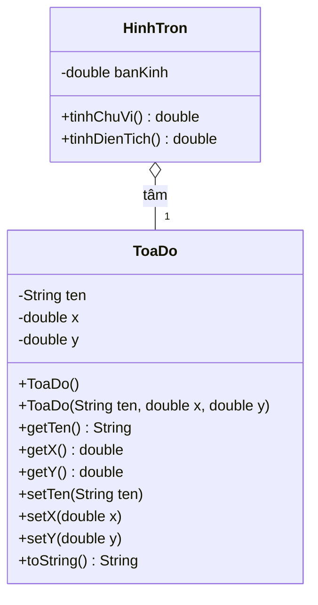
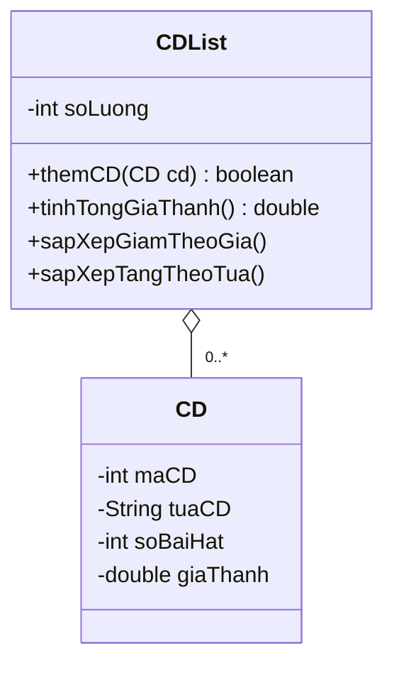
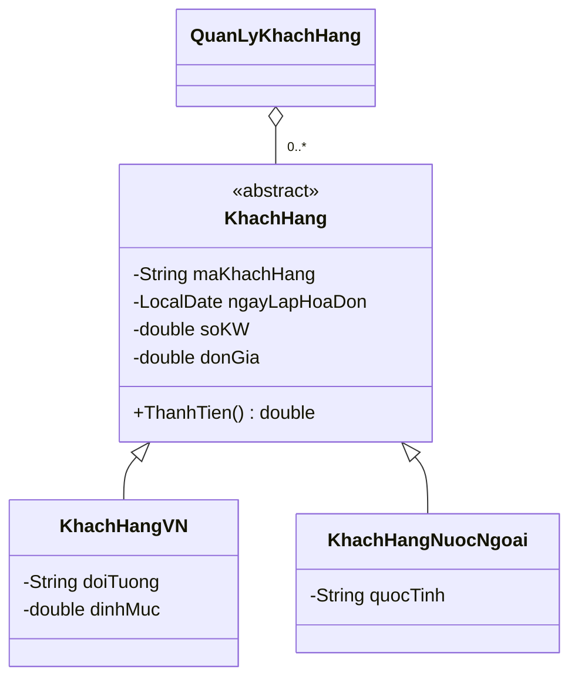
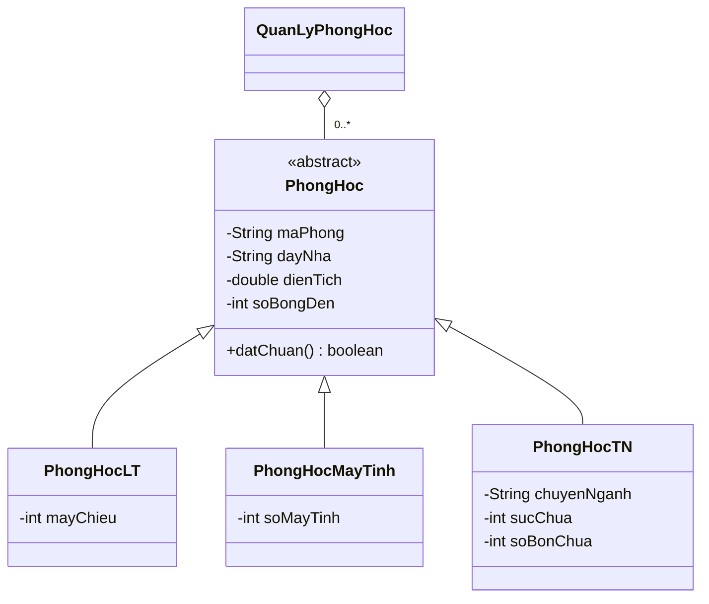

# BaiTapOOP

Project Java trong Eclipse, dùng JDK 11 trở lên. Mỗi tuần có một package riêng trong `src`. Để chạy, mở lớp trong cột **Lớp chạy** và chọn **Run As → Java Application**.

## Đối chiếu đề với repo

Thứ tự tuần theo [repo tham chiếu tại commit e0a0285](https://github.com/Taihoang07/Java_Project_Lesson/tree/e0a028542f21b85ec14b845c4d301e2004c88783). Số bài và trang bên dưới theo PDF `BT LTHDT_2019-1(5).pdf`.

| Tuần | Nội dung trong repo | Bài tương ứng trong PDF | Lớp chạy |
| --- | --- | --- | --- |
| 1 | Tọa độ, hình tròn, hình chữ nhật | Module 2, Bài 1 và 7 (trang 23, 28). Hình chữ nhật theo repo. | [ToaDoMain](src/tuan01/ToaDoMain.java), [HinhTronMain](src/tuan01/HinhTronMain.java), [HinhChuNhatMain](src/tuan01/HinhChuNhatMain.java) |
| 2 | Sinh viên và điểm trung bình | Module 2, Bài 2 (trang 23–24) | [Main](src/tuan02/Main.java) |
| 3 | Hàng thực phẩm và hạn sử dụng | Module 2, Bài 5 (trang 25–26) | [HangThucPhamMain](src/tuan03/HangThucPhamMain.java) |
| 4 | Quản lý CD bằng mảng | Module 2, Bài 8 (trang 28–29) | [TestCD](src/tuan04/TestCD.java) |
| 5 | Quản lý công nhân và tính lương | Module 2, Bài 9 (trang 29–30) | [QuanLyCongNhan](src/tuan05/QuanLyCongNhan.java) |
| 6 | Quản lý danh sách thực phẩm | Mở rộng Module 2, Bài 5 theo repo, gồm thêm, sửa, xóa, tìm, sắp xếp, lọc ngày và thống kê. | [Main](src/tuan06/Main.java) |
| 7 | Hóa đơn tiền điện | Module 3, Bài 5 (trang 37–38) | [Main](src/tuan07/Main.java) |
| 8 | Quản lý sinh viên, môn học và học phí | Gần nhất với Module 4, Bài 4 (trang 44). Phân hệ chính quy, từ xa, học phí và gom nhóm theo repo. | [TestSinhVien](src/tuan08/TestSinhVien.java) |
| 9 | Quản lý phòng học | Module 4, Bài 6 (trang 45) | [Main](src/tuan09/Main.java) |

- Tuần 1 dùng `π = 3.14` để khớp kết quả mẫu của hình tròn trong PDF.
- Tuần 2 dùng thông tin minh họa cho hai sinh viên tạo sẵn. Để chạy biến thể dùng constructor đủ tham số cho sinh viên thứ ba, nhập `--constructor` trong **Run Configurations → Arguments → Program arguments**.
- Tuần 5 tính lương lũy tiến theo số thứ tự sản phẩm. Sản phẩm thứ 200 thuộc bậc 0,55 và bộ lọc chỉ lấy người làm trên 200 sản phẩm.
- Tuần 7 theo công thức của repo cho hóa đơn vượt định mức. Phần trong định mức bằng định mức nhân đơn giá. Phần vượt bằng số kW vượt nhân đơn giá nhân 2,5. Dòng công thức trong PDF ghi thêm hệ số số kW tiêu thụ ở phần trong định mức.
- Tuần 9 làm tròn lên số bóng đèn và số máy tính tối thiểu theo mật độ trong repo. Phòng 90 m² cần ít nhất 9 bóng đèn và 60 máy để đạt chuẩn phòng máy.

## Mô hình lớp

### Tuần 1 · Tọa độ và hình tròn

### Tuần 4 · Danh sách CD

### Tuần 7 · Hóa đơn tiền điện

### Tuần 9 · Quản lý phòng học

