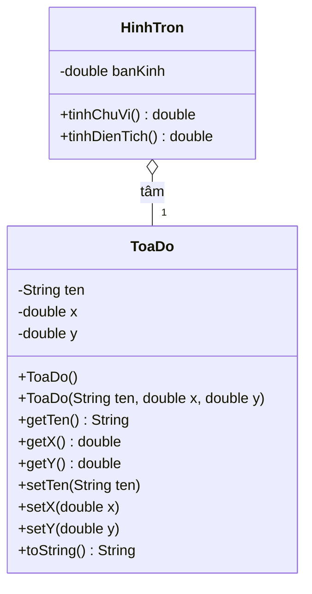
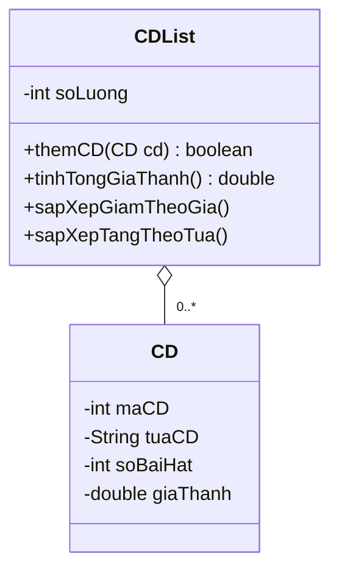
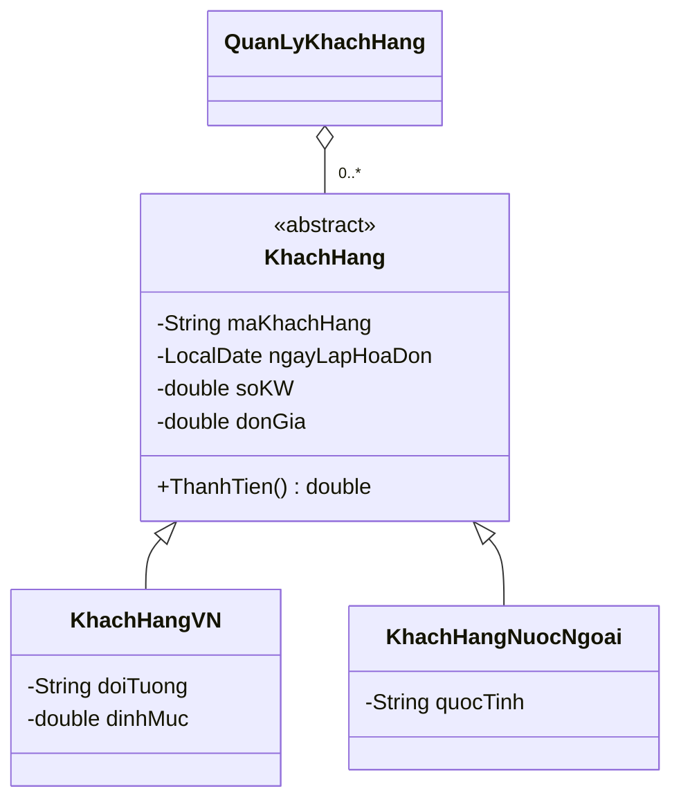
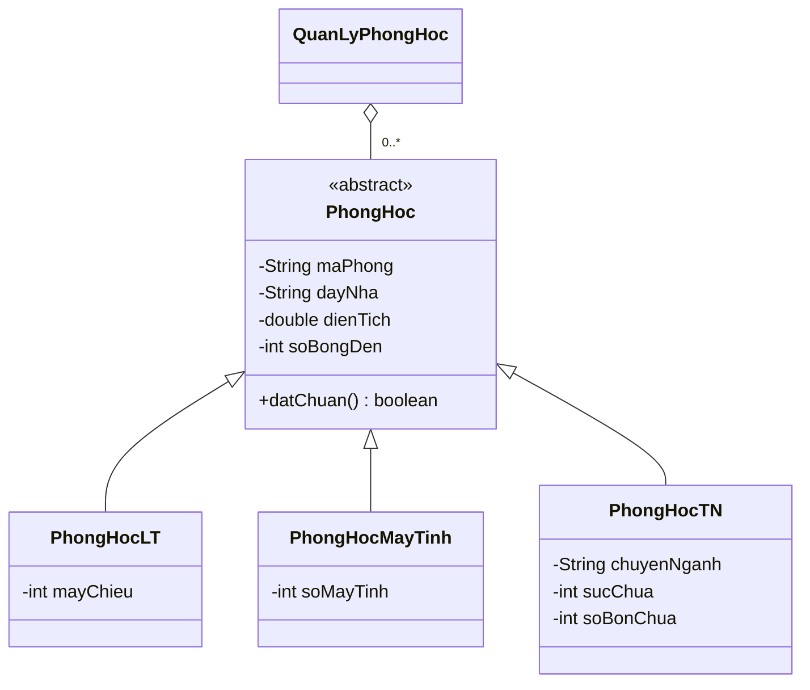

# BaiTapOOP

- Tuần 1 dùng `π = 3.14` để khớp kết quả mẫu của hình tròn trong PDF.
- Tuần 2 dùng thông tin minh họa cho hai sinh viên tạo sẵn. Để chạy biến thể dùng constructor đủ tham số cho sinh viên thứ ba, nhập `--constructor` trong **Run Configurations → Arguments → Program arguments**.
- Tuần 5 tính lương lũy tiến theo số thứ tự sản phẩm. Sản phẩm thứ 200 thuộc bậc 0,55 và bộ lọc chỉ lấy người làm trên 200 sản phẩm.
- Tuần 7 theo công thức của repo cho hóa đơn vượt định mức. Phần trong định mức bằng định mức nhân đơn giá. Phần vượt bằng số kW vượt nhân đơn giá nhân 2,5. Dòng công thức trong PDF ghi thêm hệ số số kW tiêu thụ ở phần trong định mức.
- Tuần 9 làm tròn lên số bóng đèn và số máy tính tối thiểu theo mật độ trong repo. Phòng 90 m² cần ít nhất 9 bóng đèn và 60 máy để đạt chuẩn phòng máy.

## Mô hình lớp

### Tuần 1 · Tọa độ và hình tròn

### Tuần 4 · Danh sách CD

### Tuần 7 · Hóa đơn tiền điện

### Tuần 9 · Quản lý phòng học

